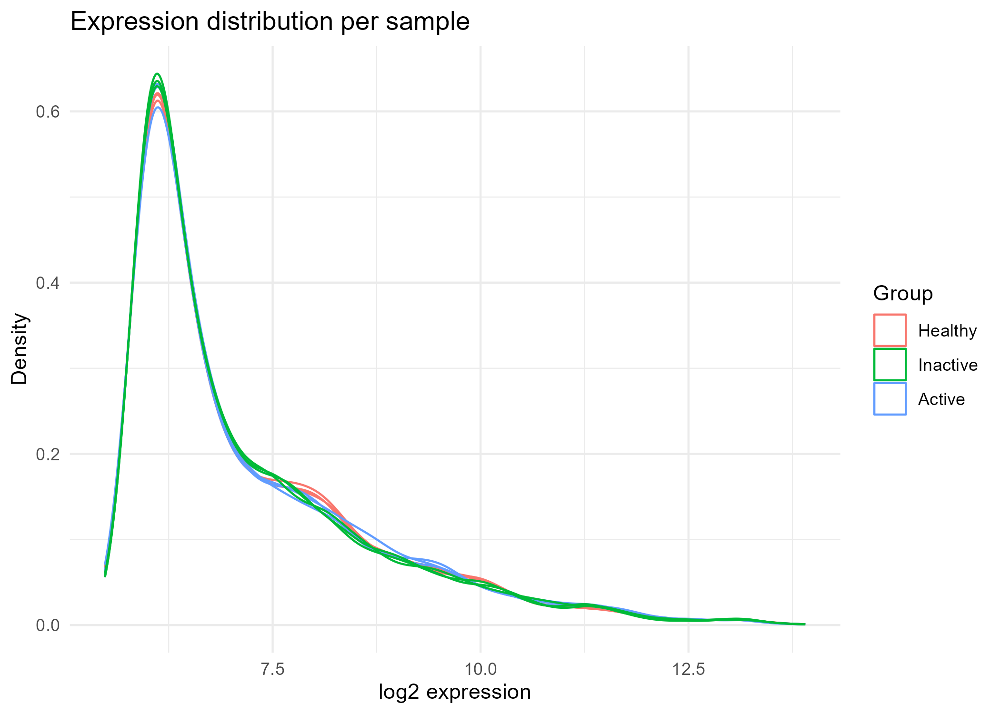
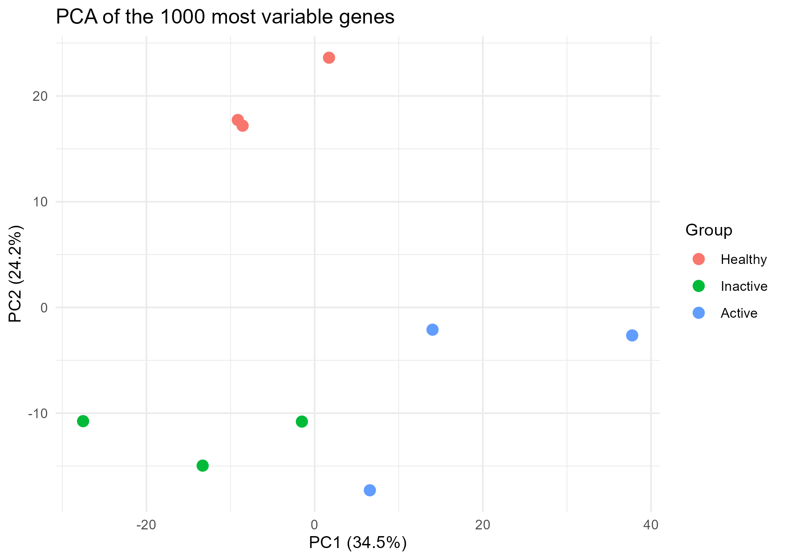
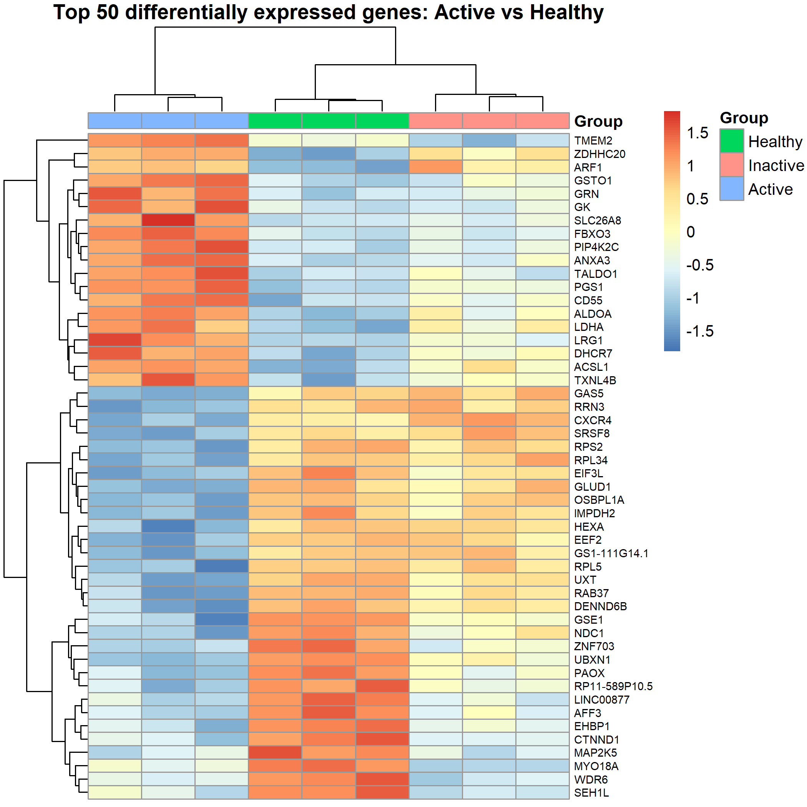

# Gene Activity in Immune Cells for Detecting Adult-onset Still's Disease

**Student registration number:** 2021ICT36

---

## Abstract

Adult-onset Still's disease (AOSD) is a rare illness where the immune system is overactive, causing fever, rash and joint pain. In this project I used public gene activity data from blood monocytes, a type of immune cell. I compared patients with active AOSD, patients with inactive AOSD and healthy people. I used limma to find genes changed in active AOSD and Gene Ontology analysis to find the processes involved. I then trained a support vector machine and a k-nearest neighbours classifier to separate active AOSD from healthy samples, using 5-fold cross-validation. Twelve genes changed significantly in active AOSD, but no biological process was enriched. The support vector machine classified all six samples correctly (100% accuracy, baseline 50%). Because the study has only nine samples, these results are preliminary and need testing in larger, independent groups.

---

## 1. Introduction

### 1.1 The real-world problem

Adult-onset Still's disease is a rare systemic inflammatory disorder. It usually starts at age 16 or older and causes skin rash, spiking fever, arthritis, sore throat, swollen lymph nodes and an enlarged liver and spleen (Tsuboi et al., 2022). The cause is still unknown. In a Japanese national survey, the estimated prevalence was 3.9 per 100,000 people (Tsuboi et al., 2022).

A serious complication called macrophage activation syndrome (MAS) can develop in some patients. MAS is life-threatening and needs fast treatment. Because the symptoms overlap with many other illnesses, diagnosis can be slow. Better tests could help doctors recognise active disease sooner.

### 1.2 Why it matters

Monocytes are immune cells that play a central role in the innate immune response. In AOSD, activated monocytes and macrophages produce high levels of the inflammatory signals IL-1β and IL-18, which contribute to many of the disease's symptoms (Tsuboi et al., 2022). Studying the genes that monocytes switch on or off in active disease may reveal biological clues and possible markers.

The original study that produced this dataset found that the gene PLAC8 was more active in monocytes from patients with active AOSD than in inactive patients or healthy controls. PLAC8 activity was linked to inflammatory markers, and the authors suggested it may help regulate IL-1β and IL-18 production (Journal of Immunology, 2018). My project builds on this idea by looking at the whole gene activity profile, not just one gene.

### 1.3 Aim and hypotheses

The main question of this project is:

> Can gene activity in monocytes separate patients with active AOSD from healthy people, and which biological processes are changed?

I tested two hypotheses:

- **H1:** Monocytes from active AOSD patients have a set of genes that are more or less active than in healthy people. These genes should be linked to inflammation and innate immune processes.
- **H2:** A small set of genes, chosen using only the training samples, can classify active AOSD versus healthy samples more accurately than a simple guess based on the largest group.

---

## 2. Data

### 2.1 Source

The data come from the NCBI Gene Expression Omnibus (GEO), a public database of gene activity studies. The dataset is **GSE113645**, titled *DNA microarray analysis of active- and inactive-adult Still disease (ASD)*.

- GEO page: https://www.ncbi.nlm.nih.gov/geo/query/acc.cgi?acc=GSE113645
- Original study: *Placenta Specific 8 Suppresses IL-18 Production through Regulation of Autophagy and Is Associated with Adult Still Disease*, Journal of Immunology, 2018.
- Data type: microarray gene expression
- Platform: GPL570, Affymetrix Human Genome U133 Plus 2.0 Array

### 2.2 Description and size

| Item | Detail |
|---|---|
| Organism | *Homo sapiens* (human) |
| Sample type | CD14+ monocytes isolated from blood |
| Groups | Active AOSD, inactive AOSD, healthy controls |
| Total samples | 9 |
| Samples per group | 3 active AOSD, 3 inactive AOSD, 3 healthy |
| Sex | 6 female, 3 male |
| Age | 42 to 61 years |
| Probes on the platform | 54,675 |
| Unique gene symbols after probe mapping | 22,880 |
| Genes after removing low-expression genes | 17,138 |
| Missing values | 0 |
| Value range after processing (log2 scale) | 5.02 to 14.03 |

### 2.3 Variables

- **Disease state:** the group each sample belongs to (active AOSD, inactive AOSD or healthy). This comes from the `disease state` field in the GEO metadata.
- **Gene expression values:** one measured value per probe per sample, on a log2 scale.
- **Gene symbols:** standard gene names (for example, PLAC8) linked to each probe.
- **Sex and age:** listed in the GEO metadata. I did not use them in the models, but I note them when interpreting the results.

### 2.4 Ethics and licensing

- The samples were collected in the original study, which is cited above. I did not collect any samples or contact any participants.
- GEO publishes only gene expression values and group labels. The data contain no names or other direct identifiers. Sex and age are given only as broad categories.
- GEO data are publicly available for reuse. I cite the GEO accession and the original study throughout this report.

---

## 3. Methods

### 3.1 Workflow overview

I followed this workflow. Each step is one section of the R notebook (`code/AOSD_Analysis.Rmd`).

1. **Import:** read the GEO series matrix file and check its contents.
2. **Define groups:** read the disease state from the metadata and label each sample.
3. **Clean and prepare:** check for missing values, log-transform if needed, map probes to genes and remove low-expression genes.
4. **Explore:** look at the data using density plots, principal component analysis (PCA) and a sample correlation heatmap.
5. **Differential expression:** use limma to compare the groups and find significant genes.
6. **Pathway analysis:** use Gene Ontology (GO) to find biological processes linked to the significant genes.
7. **Classification:** train a support vector machine (SVM) and a k-nearest neighbours (k-NN) model with 5-fold cross-validation.
8. **Check:** use k-means clustering without labels as an extra check.

### 3.2 Data cleaning

- **Missing values:** I checked for missing values and found none.
- **Log transform:** I would have log2-transformed the values if they were on the raw scale (maximum above 100). The values were already on a log2 scale, so no transformation was applied.
- **Probe to gene mapping:** each probe was linked to its gene symbol. Some probes target more than one gene. In those cases I kept the first gene listed. When a gene had several probes, I kept the probe with the highest average activity.
- **Low-expression filter:** I removed genes in the lowest 25% of average activity. These genes are mostly noise, and removing them makes the statistical tests more reliable.

### 3.3 Exploratory analysis

- **Density plots** show whether all samples have similar value spreads. Large differences would suggest technical bias.
- **PCA** was run on the 1000 most variable genes. It shows the main patterns in the data and whether they follow the disease groups.
- **Correlation heatmap** shows how similar each pair of samples is, based on the same 1000 genes.

### 3.4 Differential expression (limma)

limma fits a linear model to each gene and uses empirical Bayes moderation, which borrows information across genes. This works well when there are few samples per group. I made three comparisons: active vs healthy, inactive vs healthy, and active vs inactive. I adjusted p-values for multiple testing with the Benjamini–Hochberg method.

A gene was called **significant** if:

- its adjusted p-value (adj.P.Val) was below 0.05, **and**
- its absolute log2 fold change was above 1, meaning it changed at least two-fold.

### 3.5 Gene Ontology (GO) analysis

I split the significant genes in active vs healthy into two lists: genes higher in active AOSD and genes lower in active AOSD. I tested each list for over-represented GO biological processes using clusterProfiler, with all genes in the cleaned data as the background. Lists with fewer than 10 genes were not tested.

### 3.6 Classification (machine learning)

The classification task was active AOSD versus healthy. I excluded inactive samples from this part so the two classes were clearly separated.

- **Cross-validation:** I split the 6 samples into 5 folds with `caret::createFolds`, which keeps the class balance in each fold. Each fold was used once as the test set.
- **Feature selection inside each fold:** in each fold I chose the top 50 genes using limma and only the training samples. This avoids data leakage, which would make accuracy look better than it really is.
- **Scaling:** I scaled the selected genes using the mean and standard deviation of the training samples only.
- **Classifiers:**
  - *Linear support vector machine (SVM)* with cost = 1, from the `e1071` package.
  - *k-nearest neighbours (k-NN)* with k = 5, from the `caret` package.
- **Evaluation:** I measured accuracy, sensitivity (the proportion of active AOSD samples correctly found) and specificity (the proportion of healthy samples correctly identified). I compared the results with a baseline that always predicts the larger group.

### 3.7 Unsupervised check

I ran k-means clustering (k = 3) on the 1000 most variable genes for all nine samples, without using the group labels. I then compared the clusters with the true groups in a table. This checks whether the groups differ strongly enough to appear without labels.

### 3.8 Packages used

| Package | Purpose | Why I chose it |
|---|---|---|
| tidyverse (dplyr, tidyr, ggplot2) | Data handling and plots | Clear, standard tools for data work in R |
| GEOquery | Import GEO data | The standard way to read GEO files into R |
| limma | Differential expression | Standard, well-tested method for microarray data |
| clusterProfiler | GO enrichment | Widely used, and it works directly with gene symbols |
| org.Hs.eg.db | Human gene annotation | Needed for GO analysis of human genes |
| enrichplot | GO plots | Works with clusterProfiler output |
| pheatmap | Heatmaps | Simple heatmaps with sample annotations |
| ggrepel | Labels on the volcano plot | Stops labels from overlapping |
| caret | Cross-validation and k-NN | Common machine learning framework in R |
| e1071 | SVM | Standard SVM implementation, used by caret |

---

## 4. Results

All figures are saved in the `figures/` folder as PNG (300 dpi) and PDF files.

### 4.1 Data quality and structure



**Figure 1.** Each line is one sample, coloured by group. Samples whose curves line up closely indicate that the processing was consistent across the dataset.



**Figure 2.** Each dot is one sample. The percentage on each axis shows how much of the total variation that component explains. PCA was used to check whether the main patterns in the data follow the disease groups. The clustering result in section 4.5 shows that the three groups separate clearly on these genes.


**Figure 3.** Darker colours show samples that are more similar to each other. The coloured bars at the top and side show each sample's group.

### 4.2 Differentially expressed genes

**Table 1.** Number of significant genes in each comparison (adjusted p < 0.05 and absolute log2 fold change > 1).

| Comparison | Significant genes |
|---|---|
| Active vs Healthy | 12 |
| Inactive vs Healthy | 0 |
| Active vs Inactive | 6 |

In active AOSD compared with healthy people, 7 genes were higher and 5 genes were lower. No genes passed both thresholds when inactive AOSD was compared with healthy people.


**Figure 4.** Each dot is one gene. Red dots are higher in active AOSD, blue dots are lower, and grey dots are not significant. The labels show the ten most significant genes.



**Figure 5.** Each row is a gene and each column is a sample. Genes are scaled within each row, so red means higher and blue means lower activity than that gene's average. Rows and columns are grouped by similarity.

### 4.3 Biological processes (GO analysis)

The GO analysis found no biological process that was significantly over-represented, either among the 7 genes higher in active AOSD or among the 5 genes lower. With so few genes, the analysis has little statistical power, so this result does not rule out a biological role for these genes. No GO figures were produced.

### 4.4 Classification performance

**Table 2.** Cross-validation results for active AOSD versus healthy (5-fold, top 50 genes selected in each fold).

| Model | Accuracy | Sensitivity | Specificity |
|---|---|---|---|
| Linear SVM | 100.0% | 100.0% | 100.0% |
| k-NN (k = 5) | 16.7% | 33.3% | 0.0% |
| Majority-class baseline | 50.0% | – | – |

The SVM classified all six samples correctly across the folds: all three active AOSD samples and all three healthy samples. With only six samples, the 95% confidence interval for its accuracy is wide, from 54.1% to 100%. The accuracy was significantly better than the baseline only at the level of a p-value of 0.016, which is a weak result given the small sample.

The k-NN model used k = 5. In the fold with two test samples, the training set had only four samples, which is fewer than k. This makes the k-NN result unreliable, and it classified only one of six samples correctly.

### 4.5 Stable genes and clustering

- **Stable genes:** six genes were selected in all five folds: ALDOA, CABIN1, HIST1H2BD, RPS27L, TAF4B and UBXN1. These are the most consistent candidates from the classifier.
- **k-means clustering:** the three clusters matched the three groups exactly. Cluster 1 contained the three inactive AOSD samples, cluster 2 the three healthy samples, and cluster 3 the three active AOSD samples. No samples were mixed between groups.

---

## 5. Discussion

### 5.1 Interpretation

H1 was partly supported. Twelve genes changed between active AOSD and healthy people, seven higher and five lower. However, the GO analysis found no enriched biological process, so I could not show from my own analysis that these genes point to inflammation or innate immunity. The original study highlighted PLAC8. Checking whether PLAC8 is among my significant genes would connect my results to that work, and it is a natural next step.

Inactive AOSD samples were not significantly different from healthy samples, while active and inactive samples differed in six genes. This pattern suggests that the gene signal is linked to active disease rather than to AOSD in general. With three samples per group, this is a hypothesis for future work rather than a conclusion.

H2 was supported only in a preliminary way. The linear SVM classified all six samples correctly in cross-validation, which is above the 50% baseline. With six samples, however, the result is not reliable.

The unsupervised clustering placed the three groups into separate clusters, including inactive and healthy samples. This is surprising, because limma found no significant genes between inactive and healthy samples. The clustering used the 1000 most variable genes, which may capture differences unrelated to disease, such as sex, age or processing batch. I did not adjust for sex or age, so I cannot say which factor drives this split.

### 5.2 Limitations

- **Very small sample.** There are only nine samples, three per group. This is the biggest limitation. It makes the statistical tests less powerful, and it makes the perfect SVM result easy to over-interpret.
- **k-NN setting.** With k = 5, the k-NN model was larger than the training set in one fold, so its result is not a fair test of the method.
- **Unbalanced sex and age.** The sample has more females than males (6 and 3), and sex and age were not adjusted for. Differences between groups may partly reflect these factors.
- **No validation cohort.** The results were tested only inside this dataset. They should be treated as possible leads, not proven markers.
- **Microarray limits.** Microarrays measure only the genes printed on the chip, and they can be affected by technical differences between batches. I did not correct for batch effects because no batch information was available to me.
- **Cell type.** The data come from one cell type, monocytes. The results may not apply to whole blood or to other immune cells.
- **No GO results.** The pathway analysis found nothing significant, so the biological interpretation of the 12 genes remains open.

### 5.3 Real-world implications

If a gene signature is confirmed in larger groups, it could help doctors identify active AOSD sooner, or flag patients who may be at risk of MAS. Before any clinical use, a test would need to be checked in new, independent patient groups and compared with the current diagnostic criteria. This project only suggests where to look next.

---

## 6. Conclusion and future work

This project explored whether gene activity in monocytes can separate active AOSD from healthy people. I found 12 genes that changed in active AOSD compared with healthy people, 7 higher and 5 lower, but I found no enriched biological process to explain them. A linear SVM classified all six samples tested in cross-validation correctly, and unsupervised clustering recovered the three groups. H1 was partly supported, because genes changed but no pathway was identified. H2 was supported only in a preliminary way, because the sample is very small.

Future work could include:

- Checking whether PLAC8 and the other genes reported in the original study appear among my significant genes.
- Adding sex and age as covariates in the limma model.
- Testing the signature on an independent dataset, and on a larger sample.
- Adding the inactive AOSD group to the classifier as a third class.
- Using RNA-seq data, such as GSE150996, to check whether the same genes appear with a different technology.

---

## 7. Reproducibility

### 7.1 What you need

- R version 4.3 or newer
- RStudio (recommended)
- An internet connection for the first package installation
- About 2 GB of free disk space

### 7.2 Folder structure

```
AOSD_PROJECT/
├── README.md
├── code/
│   └── AOSD_Analysis.Rmd
├── data/
│   └── GSE113645_series_matrix.txt.gz
└── figures/
    ├── 01_expression_density.png / .pdf
    ├── 02_pca_top1000_genes.png / .pdf
    ├── 03_sample_correlation.png / .pdf
    ├── 04_volcano_active_vs_healthy.png / .pdf
    └── 05_top50_de_heatmap.png / .pdf
```

### 7.3 Steps to reproduce

1. Download the series matrix file for GSE113645 from GEO: https://ftp.ncbi.nlm.nih.gov/geo/series/GSE113nnn/GSE113645/matrix/GSE113645_series_matrix.txt.gz
2. Place the file in the `data/` folder at the repository root.
3. Open `code/AOSD_Analysis.Rmd` in RStudio.
4. Click **Knit**, or run `rmarkdown::render("code/AOSD_Analysis.Rmd")`.
5. The notebook installs any missing packages, runs the full analysis and saves the figures to `figures/`.

The first run may take several minutes because of package installation. Later runs are faster because the parsed data are cached as an `.rds` file in `data/`.

### 7.4 Package versions

The versions of all packages used are printed by `sessionInfo()` at the end of the rendered notebook. The main packages are tidyverse, GEOquery, limma, clusterProfiler, caret and e1071.

### 7.5 Random seeds

The random seed is set to 2026 at the start of the notebook, and again before the sampling and clustering steps. Running the notebook again should therefore give the same results.

---

## 8. References

1. Tsuboi H, Segawa S, Yagishita M, Toko H, Honda F, Kitada A, Miki H, Ohyama A, Hagiwara S, Kondo Y, Matsumoto I, Sumida T. Activation mechanisms of monocytes/macrophages in adult-onset Still disease. *Frontiers in Immunology*. 2022;13:953730. doi:10.3389/fimmu.2022.953730
2. Placenta Specific 8 Suppresses IL-18 Production through Regulation of Autophagy and Is Associated with Adult Still Disease. *Journal of Immunology*. 2018. PubMed ID: 30404814.
3. Gene Expression Omnibus (GEO). DNA microarray analysis of active- and inactive-adult Still disease (ASD). Accession GSE113645. National Center for Biotechnology Information. https://www.ncbi.nlm.nih.gov/geo/query/acc.cgi?acc=GSE113645 (accessed November 2026).
4. Barrett T, Wilhite SE, Ledoux P, Evangelista C, Kim IF, Tomashevsky M, Marshall KA, Phillippy KH, Sherman PM, Holko M, Yefanov A, Lee H, Zhang N, Robertson CL, Serova N, Davis S, Soboleva A. NCBI GEO: archive for functional genomics data sets—update. *Nucleic Acids Research*. 2013;41(D1):D991–D995.
5. Davis S, Meltzer PS. GEOquery: a bridge between the Gene Expression Omnibus (GEO) and BioConductor. *Bioinformatics*. 2007;23(14):1846–1847.
6. Ritchie ME, Phipson B, Wu D, Hu Y, Law CW, Shi W, Smyth GK. limma powers differential expression analyses for RNA-sequencing and microarray studies. *Nucleic Acids Research*. 2015;43(7):e47.
7. Yu G, Wang LG, Han Y, He QY. clusterProfiler: an R package for comparing biological themes among gene clusters. *OMICS*. 2012;16(5):284–287.
8. Gene Ontology Consortium. Gene Ontology: tool for the unification of biology. *Nature Genetics*. 2000;25(1):25–29.
9. Carlson M. org.Hs.eg.db: Genome wide annotation for Human. R package. Bioconductor.
10. Kuhn M. Building predictive models in R using the caret package. *Journal of Statistical Software*. 2008;28(5):1–26.
11. Meyer D, Dimitriadou E, Hornik K, Weingessel A, Leisch F. e1071: Misc Functions of the Department of Statistics, Probability Theory Group. R package. TU Wien.
12. Wickham H. *ggplot2: Elegant Graphics for Data Analysis*. Springer; 2016.
13. Wickham H, Averick M, Bryan J, Chang W, McGowan LD, François R, et al. Welcome to the tidyverse. *Journal of Open Source Software*. 2019;4(43):1686.
14. Kolde R. pheatmap: Pretty Heatmaps. R package.
15. Slowikowski K. ggrepel: Automatically Position Non-Overlapping Text Labels with 'ggplot2'. R package.
16. R Core Team. R: A Language and Environment for Statistical Computing. Vienna, Austria: R Foundation for Statistical Computing.
