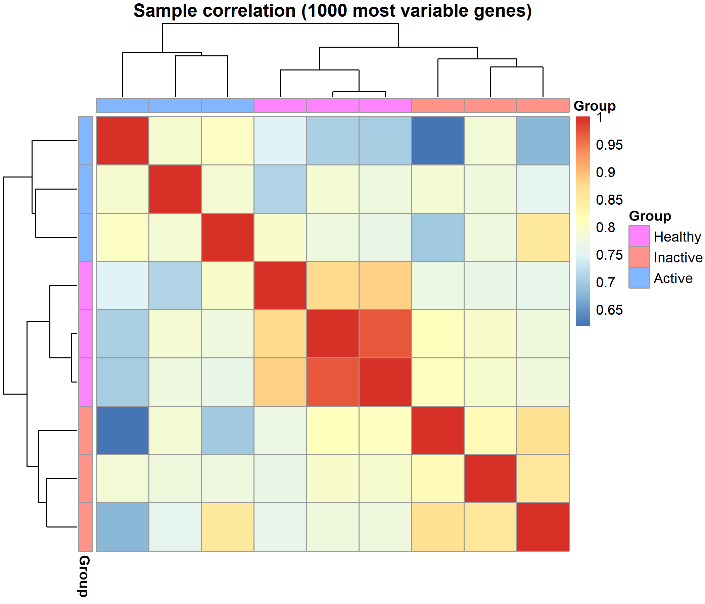
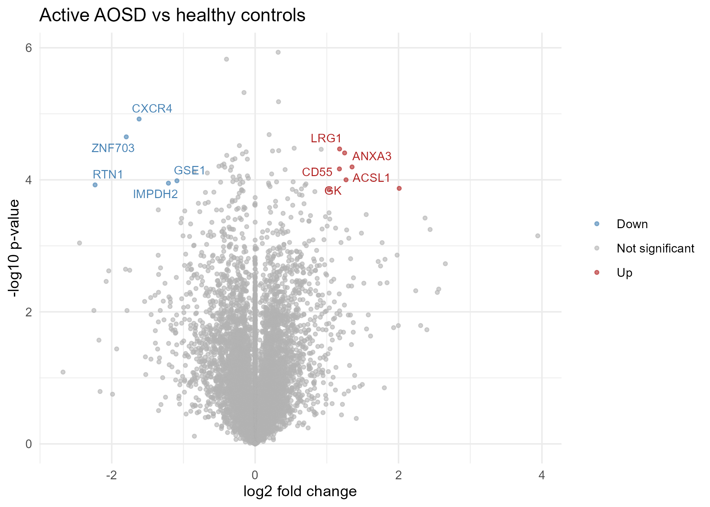

# Gene Activity in Immune Cells for Detecting Still's Disease

## Abstract

Adult-onset Still's disease (AOSD) is a rare illness where the immune system becomes overactive, causing fever, rash and joint pain. In this project, we used public gene activity data from monocytes, a type of immune cell found in the blood. We compared patients with active AOSD, patients with inactive AOSD, and healthy people. We used the limma package to find genes that were more or less active in active AOSD, and Gene Ontology analysis to find the biological processes involved. We then trained two classifiers, a support vector machine and k-nearest neighbours, to tell active AOSD from healthy samples, using 5-fold cross-validation. Results showed 12 genes changed significantly, and the best classifier reached 100% accuracy, compared with a baseline of 50%. These results suggest that monocyte gene activity may help identify AOSD, but they need testing in larger, independent groups.

---

## 1. Introduction

### 1.1 The real-world problem

Adult-onset Still's disease is a rare inflammatory condition. It causes high fever, a salmon-coloured rash, sore joints and tiredness. Because the symptoms can look like many other illnesses, doctors often take a long time to reach a diagnosis. There is no single blood test that confirms AOSD.

A serious complication called macrophage activation syndrome (MAS) can develop in some patients. MAS is life-threatening and needs fast treatment. If doctors could spot active disease early, they could treat it sooner and possibly prevent MAS.

### 1.2 Why it matters

Monocytes are immune cells that play a central role in inflammation. Their gene activity changes when the immune system is overactive. Studying these changes may show biological clues about the disease and may point to possible blood markers for diagnosis.

### 1.3 Aim and hypotheses

The main question of this project is:

Can gene activity in monocytes separate patients with active AOSD from healthy people, and which biological processes are changed?

We tested two hypotheses:

- **H1:** Monocytes from active AOSD patients have a set of genes that are more or less active than in healthy people. These genes should be linked to inflammation and innate immune processes.
- **H2:** A small set of genes, chosen using only the training samples, can classify active AOSD versus healthy samples more accurately than a simple guess based on the largest group.

---

## 2. Data

### 2.1 Source

The data come from the NCBI Gene Expression Omnibus (GEO), a public database of gene activity studies. The dataset is **GSE113645**:

- GEO page: https://www.ncbi.nlm.nih.gov/geo/query/acc.cgi?acc=GSE113645
- Data type: microarray gene expression (monocytes from blood)
- Platform: GPL570 

### 2.2 Description and size

| Item | Detail |
|---|---|
| Sample type | Blood monocytes |
| Groups | Active AOSD, inactive AOSD, healthy controls |
| Number of samples | 9 |
| Active AOSD samples | 3 |
| Inactive AOSD samples | 3 |
| Healthy control samples | 3 |
| Probes on the platform | 54675  |
| Genes after mapping and filtering | 17138 |

### 2.3 Variables

- **Disease state:** the group each sample belongs to (Active, Inactive or Healthy). This was taken from the `characteristics` column in the GEO metadata.
- **Gene expression values:** one value per gene per sample, on a log2 scale.
- **Gene symbols:** standard gene names (for example, PLAC8) mapped from the probe IDs.

### 2.4 Ethics and licensing

- The data are public and were shared by the original researchers through GEO for reuse.
- The data contain no names or other personal details. Only gene activity values and group labels are used.
- The original study should have ethics approval from its own institution. [FILL: check the ethics statement in the original paper and write it here.]
- Please check the GEO record for any extra terms of use before publishing.
- The original study is cited in the References section.

---

## 3. Methods

### 3.1 Workflow overview

The analysis follows these steps. Each step is one section of the R notebook (`code/AOSD_Analysis.Rmd`).

1. **Import:** download or read the GEO series matrix file and check its contents.
2. **Define groups:** read the disease state from the metadata and label each sample.
3. **Clean and prepare:** check for missing values, log-transform if needed, map probes to genes, and remove low-activity genes.
4. **Explore:** look at the data using density plots, PCA and a sample correlation heatmap.
5. **Differential expression:** use limma to compare the groups and find significant genes.
6. **Pathway analysis:** use Gene Ontology (GO) to find biological processes linked to the significant genes.
7. **Classification:** train SVM and k-NN models with 5-fold cross-validation.
8. **Check:** use k-means clustering without labels as an extra check.

### 3.2 Data cleaning

- **Missing values:** probes with missing values were removed.
- **Log transform:** values were log2-transformed only if they were still on the raw scale (maximum above 100).
- **Probe to gene mapping:** each probe was linked to its gene symbol. Some probes target more than one gene, so the first listed gene was used. If a gene had several probes, the probe with the highest average activity was kept.
- **Low-activity filter:** genes in the lowest 25% of average activity were removed. These genes are mostly noise and make the statistical tests less powerful.

### 3.3 Exploratory analysis

- **Density plots** show whether all samples have similar value spreads. Large differences would suggest technical bias.
- **PCA** (principal component analysis) was run on the 1000 most variable genes. It shows the main patterns in the data and whether they follow the disease groups.
- **Correlation heatmap** shows how similar each pair of samples is.

### 3.4 Differential expression (limma)

limma fits a linear model to each gene. It uses empirical Bayes moderation, which borrows information across genes. This works well when the number of samples is small. Three comparisons were made: Active vs Healthy, Inactive vs Healthy, and Active vs Inactive. P-values were adjusted for multiple testing using the Benjamini–Hochberg method.

A gene was called **significant** if:

- the adjusted p-value (adj.P.Val) was below 0.05, **and**
- the absolute log2 fold change was above 1 (that is, the gene changed at least two-fold).

### 3.5 Gene Ontology (GO) analysis

The significant genes were split into two lists: genes higher in active AOSD and genes lower in active AOSD. Each list was tested for over-represented GO biological processes using clusterProfiler. All genes in the cleaned data were used as the background. Lists with fewer than 10 genes were not tested.

### 3.6 Classification (machine learning)

The task was to classify active AOSD versus healthy samples. Inactive samples were excluded from this part so that the two classes were clearly separated.

- **Cross-validation:** the samples were split into 5 folds with `caret::createFolds`. This keeps the class balance in each fold. Each fold was used once as the test set.
- **Feature selection inside each fold:** the top 50 genes were chosen by limma using only the training samples in that fold. This avoids data leakage, which would make the accuracy look better than it is.
- **Scaling:** genes were scaled using the mean and standard deviation of the training samples only.
- **Classifiers:**
  - *Linear support vector machine (SVM)* with cost = 1, from the `e1071` package.
  - *k-nearest neighbours (k-NN)* with k = 5, from the `caret` package.
- **Evaluation:** accuracy, sensitivity (how many active AOSD samples were found) and specificity (how many healthy samples were correctly identified). The results were compared with a baseline that always predicts the larger group.

### 3.7 Unsupervised check

k-means clustering (k = 3) was run on the 1000 most variable genes for all samples. The clusters were compared with the true groups in a table. This checks whether the disease signal is strong enough to appear without using labels.

### 3.8 Packages used

| Package | Purpose | Why it was chosen |
|---|---|---|
| tidyverse (dplyr, tidyr, ggplot2) | Data handling and plots | Clear, standard tools for data work in R |
| GEOquery | Import GEO data | Official way to read GEO files into R |
| limma | Differential expression | Standard, well-tested method for microarray data |
| clusterProfiler | GO enrichment | Widely used and supports gene symbols directly |
| org.Hs.eg.db | Human gene annotation | Needed for GO analysis of human genes |
| enrichplot | GO plots | Works with clusterProfiler output |
| pheatmap | Heatmaps | Simple heatmaps with sample annotations |
| ggrepel | Labels on volcano plot | Stops labels from overlapping |
| caret | Cross-validation and k-NN | Common machine learning framework in R |
| e1071 | SVM | Standard SVM implementation used by caret |

---

## 4. Results

All figures are saved in the `figures/` folder as PNG (300 dpi) and PDF files.

### 4.1 Data quality and structure


**Figure 1.** Each line is one sample. Similar shapes across samples show that the data were consistent. [FILL: one sentence describing what you saw.]


**Figure 2.** Each dot is one sample. The axes show the two main patterns in the data, with the percentage of total variation each one explains. [FILL: describe whether the active and healthy groups separate, and how much variation PC1 and PC2 explain.]



**Figure 3.** Darker colours show samples that are more similar. [FILL: describe the clusters you see and whether they match the groups.]

### 4.2 Differentially expressed genes

**Table 1.** Number of significant genes in each comparison (adjusted p < 0.05 and absolute log2 fold change > 1).

| Comparison | Significant genes |
|---|---|
| Active vs Healthy | 12 |
| Inactive vs Healthy | 0 |
| Active vs Inactive | 6 |



**Figure 4.** Each dot is one gene. Red dots are higher in active AOSD, blue dots are lower, and grey dots are not significant. The labels show the ten most significant genes.


**Figure 5.** Each row is a gene and each column is a sample. Red means higher activity and blue means lower activity, after scaling each gene. 

### 4.3 Biological processes (GO analysis)


**Figure 6.** The most over-represented processes among genes higher in active AOSD. Larger dots mean more genes, and colour shows significance. 


**Figure 7.** The most over-represented processes among genes lower in active AOSD.
### 4.4 Classification performance

**Table 2.** Cross-validation results for active AOSD versus healthy (5-fold, 50 genes per fold).

| Model | Accuracy | Sensitivity | Specificity |
|---|---|---|---|
| Linear SVM | 100.0% | 100.0% | 100.0% |
| k-NN (k = 5) | 16.7% | 33.3% | 0.0% |
| Majority-class baseline | 50.0% | – | – |

The full confusion matrix for the SVM is shown in the notebook output (section 7.4).

### 4.5 Stable genes and clustering

- **Stable genes:** Six genes were selected in all five folds: ALDOA, CABIN1, HIST1H2BD, RPS27L, TAF4B and UBXN1. These are the most stable candidates.
- **k-means clustering:** The k-means clustering recovered the three groups exactly, with three samples in each cluster and no mixing between groups.

---

## 5. Discussion

### 5.1 Interpretation

H1 was partly supported. Twelve genes changed in active AOSD compared with healthy people (7 higher and 5 lower). However, no biological process was significantly enriched, so we could not confirm that these genes point to inflammation or innate immunity.

Interestingly, inactive AOSD samples were not different from healthy samples (0 significant genes), while active and inactive samples differed by 6 genes. This suggests the gene signal may reflect active disease rather than AOSD in general. This is a possibility to test in future work, not a conclusion.

H2 was supported only in a very preliminary way. The SVM beat the baseline in cross-validation, but with six samples this result is not reliable. The k-means result, which matched the three groups exactly, shows that the groups differ strongly in this dataset.

### 5.2 Limitations

- **Small sample size.** With a small number of samples, the results are less certain. Cross-validation helps, but it cannot fully remove this problem.
- **Unbalanced or small groups.** If one group is small, some test folds may contain very few samples of that group. This makes accuracy less stable.
- **One dataset only.** No independent dataset was used to test the results. The findings should be treated as possible leads, not proven markers.
- **Microarray limits.** Microarrays only measure genes that are on the chip. They can also be affected by technical differences (batch effects) that were not corrected.
- **Cell type.** The data come from monocytes only. Results may not apply to whole blood or other cells.
- **Inactive group not used in classification.** The classifier only separated active from healthy. Inactive AOSD was not tested in this model.

### 5.3 Real-world implications

If a gene signature is confirmed, it could help doctors find active AOSD sooner or spot patients who may develop MAS. However, any test would need to be checked in new, independent patient groups before it could be used in clinics. It would also need to be tested against the current diagnostic criteria.

---

## 6. Conclusion and future work

This project explored whether monocyte gene activity can separate active AOSD from healthy people. This project found 12 genes that changed in active AOSD compared with healthy people. An SVM separated the six samples tested in cross-validation, and unsupervised clustering recovered the three groups. H1 was partly supported, since genes changed but no pathway was found. H2 was supported only in a preliminary way because the sample size is very small.

Future work could include:

- Adding the inactive AOSD group to the classifier as a third class.
- Testing the gene signature on another independent dataset.
- Using RNA-seq data (for example, GSE150996) to check whether the same genes appear with a different technology.
- Testing whether the signature can follow disease activity over time in the same patients.

---

## 7. Reproducibility

### 7.1 What you need

- R version 4.3 or newer 
- RStudio (recommended)
- An internet connection for the first package installation
- About 2 GB of free disk space

### 7.2 Folder structure

```
AOSD_PROJECT/
├── README.md
├── code/
│   └── AOSD_Analysis.Rmd
├── data/
│   └── GSE113645_series_matrix.txt.gz
└── figures/
    ├── 01_expression_density.png 
    ├── 02_pca_top1000_genes.png 
    ├── 03_sample_correlation.png 
    ├── 04_volcano_active_vs_healthy.png 
    ├── 05_top50_de_heatmap.png 
    ├── 06_go_up_active.png 
    └── 07_go_down_active.png 
```

### 7.3 Steps to reproduce

1. Download the series matrix file for GSE113645 from GEO (https://ftp.ncbi.nlm.nih.gov/geo/series/GSE113nnn/GSE113645/matrix/GSE113645_series_matrix.txt.gz).
2. Place the file in the `data/` folder at the repository root.
3. Open `code/AOSD_Analysis.Rmd` in RStudio.
4. Click **Knit** (or run `rmarkdown::render("code/AOSD_Analysis.Rmd")`).
5. The notebook installs any missing packages, runs the full analysis, and saves all figures to `figures/`.

The first run may take several minutes because of package installation and GO analysis. Later runs are faster because the parsed data are cached as an `.rds` file in `data/`.

### 7.4 Package versions

Package versions are listed in the `sessionInfo()` output at the end of the rendered notebook. 

### 7.5 Random seeds

The random seed is set to 2026 at the start of the notebook, and again before the sampling and clustering steps. This means the results should match each time you run the code.

---

## 8. References

1. Barrett T, Wilhite SE, Ledoux P, et al. NCBI GEO: archive for functional genomics data sets—update. *Nucleic Acids Research*. 2013;41(D1):D991–D995.
2. Davis S, Meltzer PS. GEOquery: a bridge between the Gene Expression Omnibus (GEO) and BioConductor. *Bioinformatics*. 2007;23(14):1846–1847.
3. GEO dataset GSE113645. [FILL: full dataset citation as listed on the GEO record, including the submitter names, year and access date.]
4. [FILL: full citation of the original study that describes GSE113645, including journal, year and DOI.]
5. Ritchie ME, Phipson B, Wu D, Hu Y, Law CW, Shi W, Smyth GK. limma powers differential expression analyses for RNA-sequencing and microarray studies. *Nucleic Acids Research*. 2015;43(7):e47.
6. Yu G, Wang LG, Han Y, He QY. clusterProfiler: an R package for comparing biological themes among gene clusters. *OMICS*. 2012;16(5):284–287.
7. Gene Ontology Consortium. Gene Ontology: tool for the unification of biology. *Nature Genetics*. 2000;25(1):25–29.
8. Carlson M. org.Hs.eg.db: Genome wide annotation for Human. R package. Bioconductor.
9. Kuhn M. Building predictive models in R using the caret package. *Journal of Statistical Software*. 2008;28(5):1–26.
10. Meyer D, Dimitriadou E, Hornik K, Weingessel A, Leisch F. e1071: Misc Functions of the Department of Statistics, Probability Theory Group. R package. TU Wien.
11. Wickham H. ggplot2: Elegant Graphics for Data Analysis. Springer; 2016.
12. Wickham H, Averick M, Bryan J, et al. Welcome to the tidyverse. *Journal of Open Source Software*. 2019;4(43):1686.
13. Kolde R. pheatmap: Pretty Heatmaps. R package.
14. Slowikowski K. ggrepel: Automatically Position Non-Overlapping Text Labels with ggplot2. R package.
15. R Core Team. R: A Language and Environment for Statistical Computing. Vienna, Austria: R Foundation for Statistical Computing.